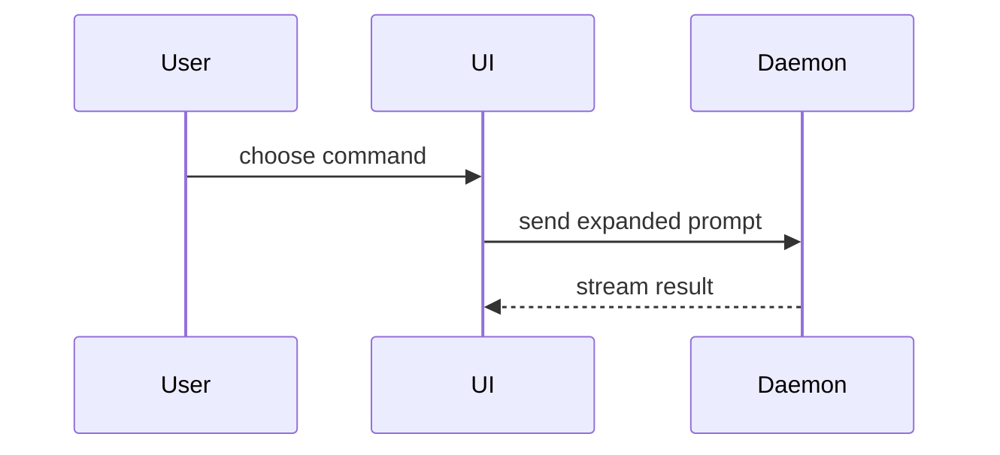

Используй этот шаблон для описания PR:

```markdown
## Summary

<diagram, diff-sketch, or tree>

## Evidence

- **Before:** <screenshot/output/failing test run>
  **After:** <screenshot/output/passing test run>

## Merge Danger

**Door:** <one-way or two-way>

<optional: description>

**Blast Radius:** <one-word description>

<optional: potential ramifications of merge>
```

## Разделы

Пропускай любые вступления, пиши прозу кратко. Используй язык предметной области пользователя из `GLOSSARY.md`.

### Summary

Выбери минимальное представление, которое делает главную мысль ясной.

- Показывай логику или алгоритм псевдокодом:

```text
on(save)
  if content is unchanged
    return cached result
  write new content
  return fresh result
```

- Показывай поток управления во время выполнения деревом вызовов:

```text
submitForm
  createSession
    persistPrompt
    launchAgent
  navigateToSession
```

- Показывай структуру UI деревом компонентов, включая состояние и важные границы модулей:

```text
<SessionPage> (apps/example/src/routes/session.tsx)
  useSessionEvents()
  <SessionToolbar>
    <RunSkillButton> (packages/ui)
```

- Показывай ответственность файлов или широкий рефакторинг неглубоким деревом файлов:

```text
src/
├── commands/       # parses user actions
├── sessions/       # owns session state
└── transport/      # sends API requests
```

- Показывай взаимодействие компонентов, поток управления или поток данных через Mermaid:



- Используй `diff`, когда суть в том, что меняется, а окружающая форма уже существует. Подбирай форму диффа под тему.

Для изменения компонента:

```diff
 <SessionPage>
   useSessionEvents()
   <SessionToolbar>
+    <RunSkillButton />
   <SessionTimeline>
+    <SkillResultCard />
```

Для изменения раскладки файлов:

```diff
 src/
 ├── commands/
+│   └── show-me.ts       # expands the slash command
 ├── sessions/
-└── transport.ts
+└── transport/
+    ├── client.ts
+    └── stream.ts
```

Для изменения дерева вызовов или стека вызовов:

```diff
 submitForm
   createSession
     persistPrompt
+    expandSkillMention
     launchAgent
-  navigateToSession
+  navigateToSession
+    subscribeToEvents
```

Для изменения состояния или потока управления:

```diff
 on(save)
-  write content
+  if content is unchanged
+    return cached result
+  write new content
+  invalidate cache
```

- Показывай блок целиком, когда большая его часть новая, когда опущенный контекст скрыл бы принадлежность или порядок, или когда пользователю нужна целевая форма, которую можно скопировать:

```ts
function expandSkill(command: string): string {
  const skillName = command.slice(1);
  return `use the ${skillName} skill`;
}
```

#### Рекомендации

Размещай каждый визуальный элемент рядом с коротким текстом, который он поддерживает. Оставляй только те вызовы, файлы, props, состояния и границы, которые нужны, чтобы ответить на текущий вопрос пользователя, или варианты для решения текущего пункта обсуждения.

Можно использовать один из этих вариантов, можно несколько; маловероятно, что понадобятся все. Полагайся на своё суждение и не перегружай пользователя.

### Evidence

Конкретные доказательства того, что изменение работает. Покажи «до» и «после».

Скриншоты относятся к уровню S (S-tier) - когда окружение для этого настроено и изменение визуальное.

Доказательства на основе запуска относятся к уровню A (A-tier). Результаты тестов, вывод консоли. Покажи псевдокодом конкретный тест, который раньше падал, а теперь проходит.

### Merge Danger

Опиши, это односторонняя или двусторонняя дверь. Через двустороннюю дверь можно вернуться обратно, через одностороннюю нельзя. PR, который дёшево откатить, менее рискован. Изменения с разрушительными действиями или трудно обратимыми решениями являются односторонними дверями.

Радиус поражения (blast radius): потенциальное влияние или охват изменений, вносимых этим PR. Учитывай все возможности. Примеры: сдвиг вёрстки, поломки у потребителей, адаптивность на мобильных и т.п.
